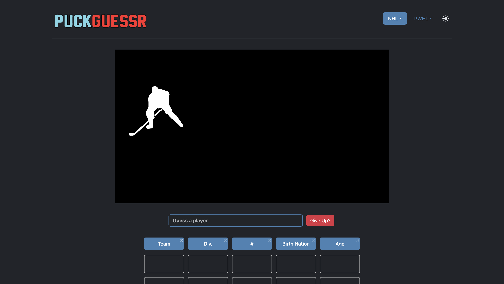
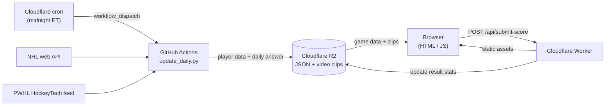

# PuckGuessr

**A daily hockey guessing game: watch a masked shot clip and work out who took it.**

**▶ Play at [puckguessr.com](https://puckguessr.com)**



PuckGuessr is a full-stack web game I designed, built, and run solo. Every player's silhouette is cut out of a real NHL or PWHL shot clip. You type in guesses, and each one reveals how close you are on various categories like team, age, player number, etc. A new daily puzzle goes live at midnight Eastern time, and the player data refreshes itself from the official league APIs. The game runs serverless on Cloudflare.

## Highlights

- **Two leagues, four modes:** NHL and PWHL, each with a shared **Daily** puzzle and an unlimited **Endless** mode that tracks your streak
- **Fully automated daily cycle:** a Cloudflare cron trigger starts a GitHub Actions job that pulls current rosters, picks the day's answer and publishes the data to R2
- **Rosters stay current:** every active NHL (~800) and PWHL (~290) player can be guessed, refreshed from the NHL web API and the PWHL HockeyTech feed
- **Fair answer selection:** daily answers don't repeat until the pool runs out, and Endless never serves a player you've already seen or today's daily answer
- **Shareable results:** a spoiler-free emoji grid, using the native share sheet on mobile, plus Endless links that let friends play the same clip
- **Community stats:** a Worker endpoint records how many guesses each player took people
- **Polished front end:** flip animations, dark mode with no flash on load, mobile layout, and search that ignores accents and punctuation (`stutzle` finds *Stützle*) with keyboard navigation

## How to play

Guess the shooter within **8 guesses (NHL)** or **6 guesses (PWHL)**. After each guess, every column turns a colour:

| Column | 🟩 Green | 🟨 Yellow | ⬛ Grey |
| --- | --- | --- | --- |
| **Team** | Same team | — | Different team |
| **Division** (NHL) | Same division | Same conference | Different conference |
| **Conference** (PWHL) | Same conference | — | Different conference |
| **#** | Same number | Within 10 | More than 10 away |
| **Birth Nation** | Same country | — | Different country |
| **Age** | Same age | Within 3 years | More than 3 years away |

When the game ends, the unmasked clip is shown with its source, and you can switch between the two versions.

## How it works



- **Front end:** static HTML pages with Bootstrap 5 and vanilla ES modules. There are no accounts. Streaks, played history, and the daily lock are kept in `localStorage`.
- **Worker** ([js/post-result.js](js/post-result.js)): serves the static assets, takes result submissions and runs the scheduled trigger. It fires at two UTC times and only acts on the one that falls at midnight in New York, so the reset follows daylight saving time.
- **Update pipeline** ([backend/update_daily.py](backend/update_daily.py)): fetches every rostered player, normalises the fields both leagues share, tells apart players with the same name, keeps existing result stats, picks the daily answer and uploads the JSON to R2. Each league updates separately, so if one fails the other still goes through. The HockeyTech requests retry when the feed sends back an error page.
- **Media:** masked and original clips are stored in R2 and served from a custom domain, named by player ID so the answer can't be read from the page.

## Tech stack

**Front end:** HTML, CSS, JavaScript, Bootstrap 5\
**Back end:** Cloudflare Workers, Cloudflare R2, Python (requests, boto3)\
**Automation:** GitHub Actions, Cloudflare Cron Triggers\
**Data:** NHL web API, PWHL HockeyTech feed

## Project structure

```
├── index.html, endless.html            NHL daily and endless pages
├── pwhl-daily.html, pwhl-endless.html  PWHL daily and endless pages
├── js/
│   ├── game-logic.js       Guessing, colouring, search, streaks
│   ├── share-logic.js      Emoji result grid
│   ├── theme-logic.js      Light and dark mode
│   └── post-result.js      Cloudflare Worker (API + cron)
├── backend/
│   ├── update_daily.py     Daily data pipeline
│   ├── refresh_players.py  Refresh rosters without changing the daily answer
│   ├── nhl_api.py, pwhl_api.py
│   └── data.py, pwhl_data.py   Team mappings and clip sources
├── .github/workflows/daily_update.yml
└── wrangler.toml
```

## Disclaimer

PuckGuessr is an independent fan project. It is not affiliated with or endorsed by the National Hockey League, the Professional Women's Hockey League, or any of their teams. Team names, league names, and footage belong to their respective owners, and each clip is credited to its source in the game. See the [Privacy Policy](https://puckguessr.com/privacy-policy.html) and [Terms of Service](https://puckguessr.com/terms-of-service.html).

## Licence

© 2026 PuckGuessr. All rights reserved. This repository is public so people can see how it works. No licence is granted to copy, modify, or redistribute the code or assets.
